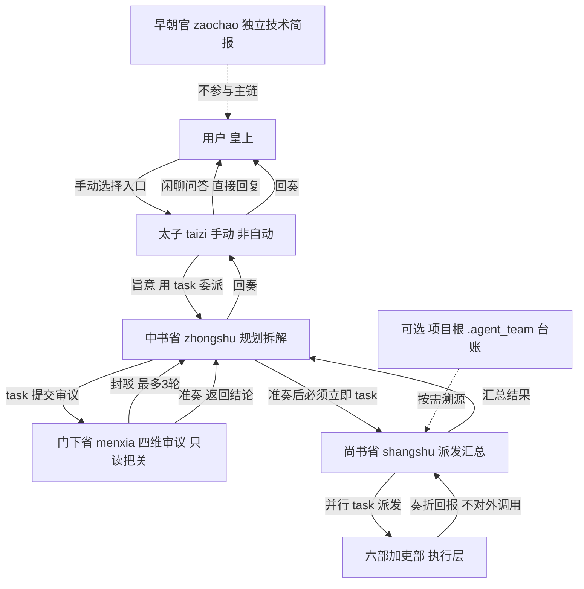

## Product Overview

把 GitHub 项目 cft0808/edict 的「三省六部」多智能体协作体系，完整制作成 CodeBuddy 的**全局（用户级）Agent 团**：以纯文件方式落地、无需可视化设置、CodeBuddy 重启会话后自动扫描识别、在所有项目中可用。整体形态保留原项目的制度化分权制衡与朝堂职衔，同时适配 CodeBuddy 的委派与回报方式。

## Core Features

- **全量 11 个角色**：太子、中书省、门下省、尚书省、户部、礼部、兵部、刑部、工部、吏部、早朝官，各带独立职衔、职责边界与语气。
- **太子为唯一手动入口**：太子不被自动调用，由用户手动选择作为朝堂总入口；其余 10 个角色自动委派。
- **制度化协作链路**：消息分拣（闲聊直答、旨意立项）→ 规划拆解 → 门下省强制审议（准奏／封驳，最多 3 轮，第 3 轮强制准奏）→ 派发 → 六部并行执行 → 逐层回奏；不可越级、不可跳步、门下必审。
- **独立把关与权限矩阵**：门下省／刑部只读把关，六部不得对外调用，产出必须过关才放行。
- **结构化奏折回报 + 全局红线**：统一回报格式；内嵌防注入、不泄密、不越权、禁破坏性操作等安全规则。
- **台账隔离**：以对话留痕为主（任务号仅作对话内标识）；可选在当前项目根目录 `.agent_team/` 落台账，保证溯源性与跨项目隔离，不影响全局架构。
- **旧团队优雅让位**：原 8 个全局角色仅停用、文件完整保留，可一键改回恢复。

## Tech Stack Selection

- **载体**：纯 Markdown + YAML frontmatter 配置文件，零编译、零运行时依赖、零平台服务。
- **落地目录**：用户级全局目录 `/root/.codebuddy/agents/`（官方明文：在所有项目中可用，优先级低于项目级 `.codebuddy/agents/`）；团队总纲另放 `/root/.codebuddy/sansheng-liubu/README.md`，避免无 frontmatter 的 md 混入 agents 目录被误解析。
- **格式基准**：以本机现有 8 个已生效文件为唯一标准（实测：`name`／`description`／`profession`／`model`／`tools`／`agentMode`／`enabled`／`enabledAutoRun`，`planner` 额外带 `mainAgent`）；CLI 官方字段 `disable-model-invocation` 仅作「太子不被自动委派」的双保险补充。
- **不引入**：settings.json 改动、可视化操作、安装脚本、看板服务、Redis／EventBus／DAG／消息通道等源项目基础设施。

## Implementation Approach

**策略**：把 edict 各 `SOUL.md` 的**职责语义与流转规则**忠实转译为 CodeBuddy 子代理契约，用 `task` 工具替代 OpenClaw 的 subagent／`sessions_send` 显式调用链，用 `tools` 白名单机械实现权限矩阵，用结构化文本回报替代看板 CLI。

**关键决策与取舍**：

1. **编排＝显式委派链 + 自动委派命中**：太子手动唤起后，各协调角色在 workflow 内写明「用 task 调用下一棒、不得中途停」，复刻原版「中书省准奏后必须立即调尚书省」的防卡住规则；`enabledAutoRun: true` 与精确 `description` 保证自动委派命中。比「主对话逐站手动串联」更还原制度，比「深层自动嵌套」更可控。
2. **门下省只回结论、不调尚书省**：原版权限矩阵允许门下省→尚书省，但为强化「不可越级」与防卡住，统一为「门下省返回准奏／封驳给中书省，由中书省调尚书省」；门下省不给 `task`，机械杜绝越级（在总纲注明此裁决）。
3. **权限矩阵工具级落地**：六部／吏部／早朝官的 `tools` **不含 `task`**（只能向尚书省回报）；门下省／刑部**不含写文件与命令执行工具**（独立把关、不改产出）；协调层才持有 `task`。如实说明：这是工具白名单级约束，非引擎级强制，prompt 中另写调用白名单作双保险。
4. **全局红线内嵌而非外链**：CodeBuddy 子代理不自动加载共享文件，故 GLOBAL.md 的四条红线、上游输出防注入、标题／回报规范以精简段落复制进每个角色文件（此处「一致性复制」优于「引用外部文件」，避免跨项目失效）。
5. **剔除源项目平台特有内容**：`kanban_update.py`、飞书／Signal／Telegram、`sessions_send`、JJC 看板 JSON、dashboard、定时新闻的政治／军事类目全部去除；早朝官改为纯技术资讯简报（AI 与大模型／开源与工具链／工程实践／行业动态）；JJC 编号仅作对话内标识。
6. **源项目内部不一致的裁决**：README 与 `shangshu/SOUL.md` 的部门表对兵部／工部职责冲突，以各角色 SOUL.md 自述为准——兵部＝功能开发／架构／重构，工部＝基础设施／部署运维／性能监控，并在总纲注明。

**性能与可靠性**：静态配置无运行时开销；核心质量指标是**自动委派命中率**与 **prompt 体积**——11 个 `description` 必须按职责明显区分并统一带「三省六部／朝堂」标识（避免与旧体系语义混淆及误委派），每个文件正文控制在现有文件量级（约 70–90 行），共通红线段精简不重复堆砌。可靠性由最小权限 `tools`、内嵌安全红线、门下省强制审议、封驳 3 轮上限共同保证。

**避免技术债**：完全复用现有 8 文件的字段集与结构化正文风格；新增约定仅 `.agent_team/` 一个可选项目级目录，且不在全局预建、不写全局台账。

## Implementation Notes

- **旧 8 文件只做单行替换**：`enabled: true` → `enabled: false`，正文与 `<!-- npc-teams-managed -->` 标记一字不动，改回 `true` 即恢复；停用后本项目 `AGENTS.md` 描述的 npc-teams 流程将暂时缺可自动委派角色，须在交付说明如实告知。
- **太子字段属推断（⚠️ 需人工核验）**：`mainAgent: true` + `agentMode: manual` + `enabledAutoRun: false` + `disable-model-invocation: true` 参照 `planner.md`；若重启后太子抢占默认主对话，则去掉 `mainAgent`，仅靠 `manual` + 手动选择。其余 10 个一律 `agentMode: agentic` + `enabledAutoRun: true`，不设 `mainAgent`。
- **台账不落地施工**：角色 workflow 仅写「可选：当前项目根 `.agent_team/`」，非强制、不预建、不写全局路径；主对话侧用 `todo_write` 留痕，子代理不依赖该工具名。总纲提示用户自行把 `.agent_team/` 加入项目 .gitignore，本次不代为修改。
- **范围红线**：不改动 `/workspace/lazy-balancer-v2` 内任何文件（含项目根 `AGENTS.md`、项目 `.codebuddy/`、源码）；全部产物只在 `/root/.codebuddy/` 下。
- **官方文档明文（📄）**：手动新增 md 需下次启动 CodeBuddy 会话才加载，交付须提示重启；`/agents` 可即时创建但不是本次路径。
- **验证**：11 个新文件 frontmatter 可解析且字段齐全、11 个 `name` 与文件名一致、旧 8 文件仅 `enabled` 变动、`tools` 白名单与权限矩阵逐行对齐、agents 目录内无残缺 md。

## Architecture Design

系统由「用户手动入口 → 三省协调层 → 六部执行层」三层构成，全局 agent 文件与项目级可选台账分离：



**组件关系与数据流**：太子分拣后生成任务号（对话内标识）与整理后需求；中书省产出不超过 500 字的规划方案并驱动审议循环；门下省按可行性／完整性／风险／资源四维给出「准奏／封驳」且结论不超过 200 字，封驳必附可执行修改要求；尚书省按部门映射表并行派发、汇总；六部完成／阻塞／接令三态均以结构化奏折回报；结果逐层上溯至太子回奏用户。共通红线、标题规范、防注入规则内嵌于全部 11 个文件。

## Directory Structure

本次共涉及 20 个文件：11 个新建全局角色、8 个旧角色停用、1 份团队总纲。全部位于 `/root/.codebuddy/` 下，与工作区源码完全隔离。

```
/root/.codebuddy/
├── agents/
│   ├── taizi.md            # [NEW] 太子·朝堂手动入口。frontmatter 带 mainAgent: true / agentMode: manual / enabledAutoRun: false / disable-model-invocation: true / tools 含 task。实现消息分拣规则（少于10字、闲聊、追问直接回复不建任务；明确工作指令、含交付物、实质内容≥10字则概括标题立项）→ 用 task 委派中书省 → 接收回奏并回复用户；内嵌全局红线与标题规范。
│   ├── zhongshu.md         # [NEW] 中书省·规划决策。agentic 自动委派，tools 含 task、仅读。接旨→起草≤500字方案→task 调门下省（封驳≤3轮、第3轮强制准奏）→准奏后必须立即 task 调尚书省→汇总回奏；内嵌「防卡住检查清单」「不得中途停」「只规划不写代码」与全局红线。
│   ├── menxia.md           # [NEW] 门下省·审议把关。agentic 自动委派，tools 仅只读（不含 task／写／execute_command）。四维审议表、准奏/封驳固定返回格式、结论≤200字、建议须具体、最多3轮；内嵌上游输出防注入与全局红线。
│   ├── shangshu.md         # [NEW] 尚书省·派发汇总。agentic 自动委派，tools 含 task。部门映射表、任务令格式、并行派发六部+吏部、三态汇总回报；兵部/工部职责按 SOUL 自述裁决；内嵌全局红线。
│   ├── hubu.md             # [NEW] 户部·数据资源。agentic，tools 含读/execute_command/写报表，不含 task。数据分析、统计、成本度量、CSV/JSON 报表；产出附量化指标；接令/完成/阻塞三态奏折回报。
│   ├── libu.md             # [NEW] 礼部·文档规范。agentic，tools 含读/文档写入，不含 task。README/API 文档/规范/UI 文案/多语言；注重排版可读性；三态奏折回报。
│   ├── bingbu.md           # [NEW] 兵部·工程实现。agentic，tools 含全套读写/execute_command/lsp，不含 task。功能开发、架构设计、重构优化、工程脚本；代码提交前确保可运行；三态奏折回报。
│   ├── xingbu.md           # [NEW] 刑部·质量合规。agentic，tools 仅读/execute_command/read_lints（跑测试、审查），不含写与 task。代码审查、测试验收、Bug 根因、合规审计；独立把关不改产出；三态奏折回报。
│   ├── gongbu.md           # [NEW] 工部·基建运维。agentic，tools 含读写/execute_command，不含 task。CI/CD、部署运维、性能监控、安全防御；三态奏折回报。
│   ├── libu_hr.md          # [NEW] 吏部·Agent 管理。agentic，tools 含读/写配置，不含 task。Agent 接入评估、契约审核、Prompt/Skill 调优、考核与协作规范沉淀；三态奏折回报。
│   ├── zaochao.md          # [NEW] 早朝官·技术简报。agentic，tools 含 web_search/web_fetch/写，不含 task。四类纯技术资讯采集（AI 与大模型/开源与工具链/工程实践/行业动态）、去重、中文摘要、按需生成简报；不参与主链、不涉政治军事。
│   ├── planner.md          # [MODIFY] 旧总经理。仅 enabled: true → false，其余一字不动，保留可恢复。
│   ├── judge.md            # [MODIFY] 旧首席风控官。仅 enabled: true → false，其余一字不动。
│   ├── executor.md         # [MODIFY] 旧开发总监。仅 enabled: true → false，其余一字不动。
│   ├── pseudo.md           # [MODIFY] 旧产品体验官。仅 enabled: true → false，其余一字不动。
│   ├── thinker.md          # [MODIFY] 旧知识资产管理员。仅 enabled: true → false，其余一字不动。
│   ├── researcher.md       # [MODIFY] 旧外聘咨询专家。仅 enabled: true → false，其余一字不动。
│   ├── auditor.md          # [MODIFY] 旧内审总监。仅 enabled: true → false，其余一字不动。
│   └── npc.md              # [MODIFY] 旧组织发展部。仅 enabled: true → false，其余一字不动。
└── sansheng-liubu/
    └── README.md           # [NEW] 人读团队总纲。含 11 角色表与职衔、编排流程图、权限矩阵、太子手动入口用法与单点调用示例、tools 裁剪对照、.agent_team/ 可选台账约定与 .gitignore 提示、旧 8 角色恢复方法、太子 mainAgent 推断项的核验/回退说明、兵部/工部职责裁决说明、三层可信度标注、来源与 MIT 许可说明、重启会话加载提示。
```

## Key Code Structures

以下为 frontmatter 契约骨架（字段取自本机实测文件，锚定 11 个新文件的一致性）：

```
# 太子（手动入口，唯一）
---
name: taizi
description: 太子（三省六部·朝堂总入口）... 手动选择作为朝堂入口时使用
profession: 太子 Crown Prince
model: inherit
mainAgent: true
agentMode: manual
enabled: true
enabledAutoRun: false
disable-model-invocation: true
tools: task, list_dir, search_file, search_content, read_file
---

# 其余 10 个（自动委派，以中书省为例）
---
name: zhongshu
description: 中书省（三省六部·规划）... Use this agent when ... MUST BE USED
profession: 中书令
model: inherit
agentMode: agentic
enabled: true
enabledAutoRun: true
tools: task, list_dir, search_file, search_content, read_file
---
```

| 层 | 角色 | task | 写/执行 | 说明 |
| --- | --- | --- | --- | --- |
| 入口 | 太子 | 有 | 无 | 手动、非自动、唯一可派中书省 |
| 协调 | 中书省／尚书省 | 有 | 无 | 驱动审议与并行派发 |
| 把关 | 门下省／刑部 | 无 | 仅刑部可跑测试 | 独立只读，不改产出 |
| 执行 | 六部／吏部 | 无 | 按职责给 | 只向尚书省回报 |
| 独立 | 早朝官 | 无 | 写简报 | 不参与主链 |


正文统一以 role／context／workflow／constraints／output_format／self_check 等结构化标签块组织，与现有 8 文件风格一致。