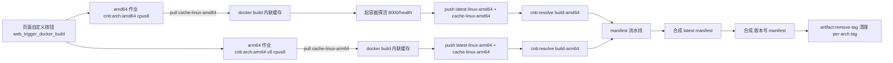

## Product Overview
为当前仓库 `lazy-balancer-v2`（CNB：`xzydm/lazy-balancer-v2`，Go 1.26 + Vue 3 单容器镜像）补齐 CNB 流水线配置，参照用户另一个仓库的 `.cnb.yml`，重点实现两类事件：**云原生开发环境事件**（`$` → `vscode`）与**镜像构建事件**（`$` → `web_trigger_docker_build`），并自动适配仓库名（全部使用 CNB 内置变量，仓库名零硬编码）。

## Core Features
- **开发环境事件**：仓库页面点击「云原生开发」即拉起基于 `debian:13-all` 的远程开发容器，自动配好 Go 1.26 / Node 22 / sqlite 工具链（安装幂等、可重复启动），带 docker 服务，长驻保活 16 小时。
- **镜像构建事件**：页面自定义按钮手动触发 → amd64 与 arm64 两个**原生架构**作业并行编译构建 → 真起容器对 `/health` 探活（构建绿 ≠ 镜像能跑）→ 推送 per-arch 镜像 → 合成 `latest` 与版本号双 manifest → 清理临时的 per-arch tag。
- **构建加速**：每架构共享一组依附于制品库的层缓存 tag（`cache-linux-amd64` / `cache-linux-arm64`），二次构建走增量。
- **构建自包含**：Dockerfile 增加 node 前端构建阶段，CI 与本地都不再需要手工 `npm run build`。
- **文档同步**：README（中/英）的从源码构建步骤同步更新，标注 CI 产物落 CNB 制品库。


## Tech Stack Selection
- 复用现有：CNB 云原生构建（`.cnb.yml` 声明式流水线）、Docker BuildKit（Dockerfile 已在用 `--mount=type=cache`）、`cnbcool/manifest` 插件、`cnb:await` / `cnb:resolve` / `artifact:remove-tag` 内置任务。
- 前端构建新增镜像：`node:22-alpine`（`web/package.json` 要求 vite ^8.2.1 / vue-tsc ^3.3.10 / TS ^5.9）。
- 开发环境基础镜像：`docker.cnb.cool/xzydm/mirrors/debian:13-all`（用户指定）。
- 不引入任何新的源码依赖，不动 Go / Vue 业务代码。

## Implementation Approach
**策略**：保持参考配置的成熟骨架（三 pipeline：amd64 / arm64 / manifest），只做「适配 + 加固」三处改动：①前端构建下沉到 Dockerfile；②版本号可由入参注入、默认读 Dockerfile `ARG VERSION`；③每架构加一层 cache tag 实现跨构建层缓存。

**关键技术决策与权衡**
1. **不做 QEMU 多架构**：本仓库最重一步是 `xcaddy build`（编译 Caddy + coraza 等 6 个插件），冷缓存历史达 40 分钟级，QEMU 模拟下不可接受 → 沿用两套原生 runner（`cnb:arch:amd64` / `cnb:arch:arm64:v8`）并行 + manifest 合成，与参考一致。
2. **前端构建入 Dockerfile**（用户决策）：当前 `Dockerfile:100` 是 `COPY web/dist /app/ui`，而 `web/dist` 不入库 —— 这是 CI 无法工作的硬阻塞。下沉后 `docker build` 自包含，流水线无隐式前置步骤；代价是改动了 Dockerfile，但用 `--mount=type=cache,target=/root/.npm` 抵消重复 `npm ci` 开销。
3. **层缓存用「内联缓存 + 专用 cache tag」**：`--build-arg BUILDKIT_INLINE_CACHE=1` + 推 `cache-linux-<arch>` tag，比 `--cache-to type=registry,mode=max` 对默认 docker driver 更稳（后者依赖驱动支持，易在 dind 环境翻车）。per-arch 构建 tag 仍然删除，只保留 cache tag，避免制品库 tag 膨胀。
4. **真容器探活**：复刻参考的「构建成功 ≠ 镜像能跑」教训，但探针改为**容器内 busybox wget 打 `8000/health`**（免鉴权端点，`internal/middleware/middleware.go:312`；`127.0.0.1:8000` 默认端口）。双探针形态与 `docker-compose.yml` 健康检查一致：`wget --no-check-certificate https://.../health || wget http://.../health`（面板可能走自签 HTTPS）。用 `docker exec` 而非宿主机端口映射，规避 dind 网络与宿主工具缺失。
5. **超时显式化**：CNB Job 默认最长 2h、无输出超时 10min，xcaddy 冷编译有触顶风险 → 构建作业显式 `timeout: 4h`（上限 12h）。
6. **manifest 模板保持 `latest-OS-ARCH`**（不得写 `latest-linux-OS-ARCH`，插件是裸子串替换会变成 `latest-linux-linux-amd64` 而 404）。

## Architecture Design
三条流水线之间的关系（镜像构建事件）：



## Implementation Notes（执行细节，防止返工）
- **仓库名零硬编码**：一律 `${CNB_DOCKER_REGISTRY}/${CNB_REPO_SLUG_LOWERCASE}`、`${CNB_REPO_NAME_LOWERCASE}`。建议在 amd64/arm64/manifest 三个 pipeline 各自用 `IMAGE_BASE` 表达，减少重复。
- **版本号解析**：Dockerfile 里有 `ARG VERSION=v2.3.4` 和 `ARG CRS_VERSION=v4.28.0`，解析必须精确锚定：
  `VERSION="${VERSION:-$(sed -n 's/^ARG VERSION=//p' Dockerfile | head -1)}"`。
  因跨 stage 传参机制不依赖更稳，**在每个需要它的 stage 内各自求值**，而不是只算一次。
- **manifest 作业的 VERSION 需同源**：第三个 pipeline 同样从已 checkout 的 Dockerfile 解析（同 commit 必然同值），不要试图从 await 里取值。
- **smoke test 清理**：`trap "docker rm -f $cid >/dev/null 2>&1 || true" EXIT` 必须保留，失败路径也要 `docker logs $cid | tail -40` 后 `exit 1`；轮询窗口给到 ~90 次 × 1s（`docker-entrypoint.sh` 首启要 `--init` 建库并拉起 Caddy 监督器）。
- **cache tag 拉取失败不能中断**：`docker pull ${CACHE_TAG} || true`（首次构建必然不存在）。
- **dev 环境幂等**：每次启动都会跑 stages，安装步骤写成 `command -v go || <安装>`，PATH 写入 `/etc/profile.d/` 与 `~/.bashrc`；Go/Node 下载优先国内镜像、失败回退官方源，最后打印 `go version` / `node -v` / `sqlite3 --version`。
- **`launch` 选项**：本仓库没有 `keepalive.py`，参考的 `launch: python keepalive.py` 不可直接照搬；`onlyPreview: false` 场景下 `launch` 不是业务端口探测的前提，改用不依赖仓库文件的 inline 长驻命令（配 `daemon: true`、`keepAliveTimeout: 16h`）。
- **不要 ** 触碰现有 Dockerfile 的 `^ARG VERSION=` 行、`--mount=type=cache` 写法与 3 次重试逻辑；新增的 node 阶段要能兼容 `web-builder` 与已有 `xcaddy-builder` / `backend` / final 阶段顺序。
- **README**：删掉「从源码构建」里的人工 `cd web && npm install && npm run build` 步骤；指出 CI 会推到 CNB 制品库（README 中原有的 Docker Hub 前缀 `v55448330/...` 属历史信息，注释说明即可，不要擅自改动用户的 Docker Hub 发布路径）。

## Directory Structure Summary
新建 2 个流水线配置文件，改造 Dockerfile 的成品镜像阶段，同步两份 README。

```
/workspace
├── .cnb.yml                  # [NEW] CNB 流水线主配置。$: vscode（debian:13-all + cpus 8 + docker/vscode 服务 + 幂等安装 Go1.26/Node22/sqlite 的 stages）；$: web_trigger_docker_build（amd64/arm64/manifest 三条 pipeline，含内联层缓存、真实容器 /health 探活、cnb:await|resolve 协同、双 manifest 合成与 per-arch tag 清理）。全部仓库名使用内置变量，含中文「为什么」注释。
├── .cnb/
│   └── web_trigger.yml       # [NEW] 自定义按钮定义（event: web_trigger_docker_build）。声明按钮名/描述、VERSION input（默认取 Dockerfile 默认版本，可手填）、permissions 限定 owner/master/developer，reg 限定主分支。
├── Dockerfile                # [MODIFY] 新增 `FROM node:22-alpine AS web-builder` 阶段：COPY web/package*.json → `RUN --mount=type=cache,target=/root/.npm npm ci`（npm 源不可达时改用 registry.npmmirror.com）→ COPY web/ → `RUN --mount=type=cache npm run build`；final 阶段把 `COPY web/dist /app/ui` 改为 `COPY --from=web-builder /app/web/dist /app/ui`。
├── README.md                 # [MODIFY] 「从源码构建」段落：去掉人工 npm build 步骤，改为一条 docker build(x) 命令；补一句 CI 通过 CNB 页面按钮构建产物落在 `docker.cnb.cool/xzydm/lazy-balancer-v2`。
└── README.en.md              # [MODIFY] 与 README.md 对等的英文段落同步更新。
```

## Key Code Structures
流水线核心变量与矩阵（写出以精确锁定接口，避免实现时漂移）：

```yaml
# 每个 pipeline 各自声明，禁止硬编码仓库名
env:
  IMAGE_BASE: ${CNB_DOCKER_REGISTRY}/${CNB_REPO_SLUG_LOWERCASE}
  IMAGE_TAG: ${CNB_DOCKER_REGISTRY}/${CNB_REPO_SLUG_LOWERCASE}:latest-linux-amd64   # arm64 作业为 latest-linux-arm64
  CACHE_TAG: ${CNB_DOCKER_REGISTRY}/${CNB_REPO_SLUG_LOWERCASE}:cache-linux-amd64    # arm64 作业为 cache-linux-arm64
```

```yaml
# manifest 插件：template 只能写 latest-OS-ARCH（OS/ARCH 是裸子串替换）
target:   ${CNB_DOCKER_REGISTRY}/${CNB_REPO_SLUG_LOWERCASE}:latest        # 第二处换成 :${VERSION}
template: ${CNB_DOCKER_REGISTRY}/${CNB_REPO_SLUG_LOWERCASE}:latest-OS-ARCH
platforms: [linux/amd64, linux/arm64]
username: ${CNB_TOKEN_USER_NAME}
password: ${CNB_TOKEN}
```


## Agent Extensions
### Skill
- **cnb-pipeline**
  - Purpose: 按 CNB 官方流水线语法编写与校验 `.cnb.yml`、`.cnb/web_trigger.yml`，核查 `runner.cpus/tags`、`services`、`env`、`timeout`、`cnb:await|cnb:resolve|artifact:remove-tag` 用法是否正确
  - Expected outcome: 产出语法合规、可在 CNB 直接运行的双事件流水线配置
- **cnb-docs**
  - Purpose: 复核 web_trigger inputs 注入形式、vscode 服务 options（launch/daemon/keepAliveTimeout/onlyPreview）与 Job 超时上限等平台细节
  - Expected outcome: 消除语法与平台能力上的臆测，配置一次通过
