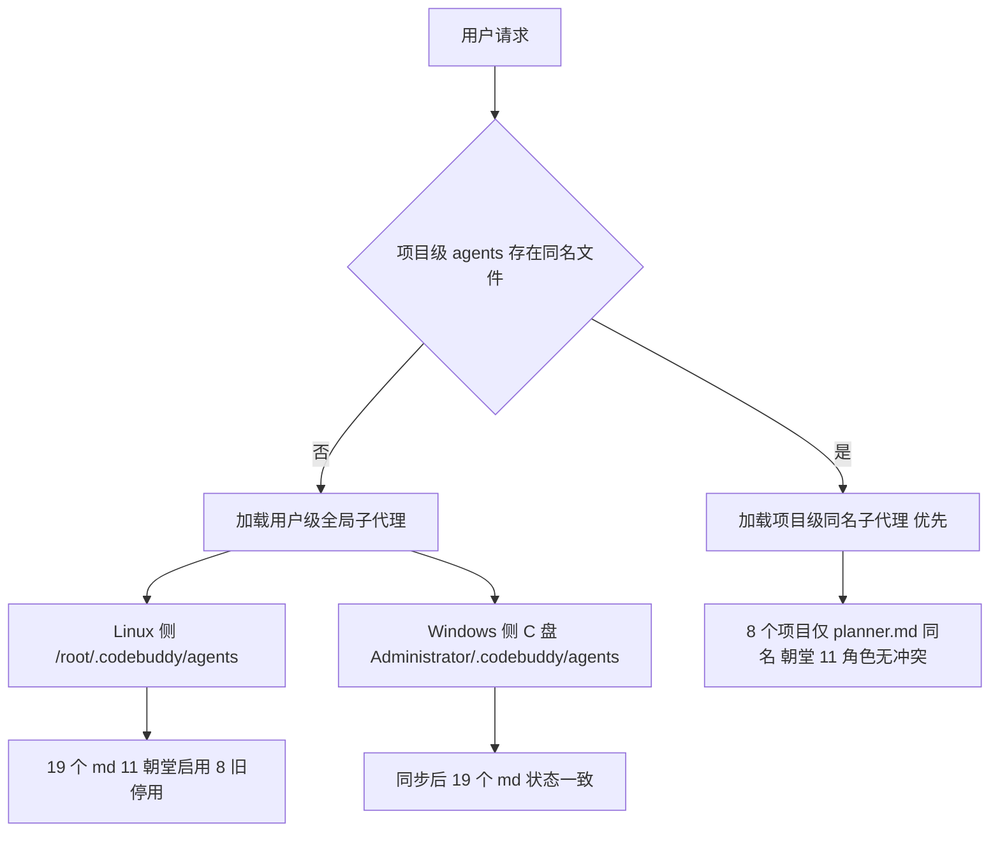

## 产品概述

把已在 Linux 侧生效的三省六部全局 Agent 团完整同步到 Windows 侧用户级目录，使两端角色清单、启用状态、团队总纲完全一致；同时在总纲中补写「生效范围与优先级边界」说明，明确项目级 Agent 与全局 Agent 的覆盖关系，消除「项目级文件会让全局失效」的疑虑。

## 核心功能

- Windows 侧新增 11 个朝堂角色，内容与 Linux 侧逐字一致。
- Windows 侧旧 8 个 npc-teams 角色仅停用、原文完整保留，可随时改回恢复。
- 总纲补写边界章节并同步两端，覆盖官方同名优先语义、当前工作区无冲突结论、8 个其他项目仅 planner 同名的隔离说明、两端路径与恢复方法、重启加载提示。
- 8 个其他项目的项目级 Agent 文件保持不动，工作区零改动。
- 交付两端一致性校验结果与推断项核验、回退说明。

## 技术栈选型

- 载体：纯 Markdown 加 YAML frontmatter 配置文件，零编译、零运行时依赖；沿用现有 19 个文件的字段集与 `<!-- edict-sansheng-liubu-managed -->` / `<!-- npc-teams-managed -->` 标记。
- 落地目录：两端用户级 `agents/`——Linux 侧 `/root/.codebuddy/agents/`（唯一事实源）、Windows 侧 `/mnt/c/Users/Administrator/.codebuddy/agents/`（已验证可写）；总纲分别位于 `/root/.codebuddy/sansheng-liubu/README.md` 与 `/mnt/c/Users/Administrator/.codebuddy/sansheng-liubu/README.md`（该侧目录需创建，放 agents 目录之外避免被解析为子代理）。
- 工具：文件写入用 write_to_file / replace_in_file；逐字复制用 cp；校验用 md5sum、python3 配合 PyYAML、grep、git status。
- 不引入：settings.json 改动（已确认只有插件开关、无 agent 注册机制）、安装脚本、项目级 agents 变更、任何台账预建。

## 实现思路

以 Linux 侧 11 个朝堂角色文件为唯一事实源逐字复制到 Windows 侧；Windows 侧旧 8 个就地单行停用；总纲追加边界章节后再逐字同步到 Windows 侧。关键决策与取舍：

1. **逐字复制而非重新生成**：保证两端契约完全一致，避免手工重写引入字段或提示词漂移；用 md5 基线逐文件校验。
2. **单行替换而非整文件覆盖**：两端旧 8 文件 frontmatter 存在实质差异（Windows 侧保留 `mcp_get_tool_description`、`mcp_call_tool`、`agentMode: agentic`、`enabledAutoRun: false`、`mainAgent: true`），用 Linux 侧旧文件覆盖会破坏 Windows 侧原有配置；只改 `enabled` 一行可保证可逆与最小影响面。
3. **依据官方同名冲突优先语义**：项目级 agents 仅在名称相同时覆盖用户级，不是整体屏蔽。8 个其他项目与全局 19 个名字的交集只有 `planner.md`，朝堂 11 个名字无同名文件，故这些项目的项目级文件保持不动即可，仅在文档中说明边界。
4. **总纲一致但各自独立**：两端各放一份，恢复旧体系时分别改各自目录的 `enabled`，互不影响。
5. **推断项如实标注**：Windows 侧 `planner.md` 停用后仍残留 `mainAgent: true`、`enabled: false` 是否彻底停用属推断，需重启后人工核验并给出回退步骤。

性能与可靠性：静态配置无运行时开销；本轮为 11 个小文件复制（合计约 55KB）加 8 处单行编辑，时间与空间复杂度均为 O(文件数)；瓶颈是跨挂载点 `/mnt/c` 的写入，已验证可写，复制后必须以 md5 与 YAML 解析做机械校验，避免「假装完成」。避免技术债：完全复用现有字段、标记与恢复方式，不新增任何机制或目录约定。

## 执行要点

- 复制前确认 Windows 侧无朝堂同名文件（已验证冲突集合为空），避免误覆盖；复制后逐一比对 md5 基线。
- Windows 侧旧 8 文件 `^enabled:` 行各恰好 1 行，使用带 `enabledAutoRun` 上下文的精确替换，避免误伤正文；正文、`<!-- npc-teams-managed -->` 标记、`mcp_*` 工具与 `agentMode` 必须原样保留。
- 边界章节须含六项：官方同名优先语义（官方明文，非整体屏蔽）、当前工作区无项目级 agents 故全局完整生效、8 个其他项目仅 planner 同名且朝堂规划位是 `zhongshu` 不受影响、项目级文件不删除不停用、两端路径与分别恢复方法、重启会话加载提示（官方明文）。
- 范围锁：不改动 8 个项目级目录（其中 `find_dev - 副本` 路径含空格，做快照对比时须正确引用）、不改动 `/workspace/lazy-balancer-v2` 任何文件（含项目根 AGENTS.md 与 `.codebuddy/plans/`）、不改动 `/root/.codebuddy/agents/` 任何现有文件、不改 settings.json、不删任何目录。
- 可信度标注统一为纯文字「实测证据 / 官方明文 / 推断项」，来源与推断不得混用；交付须提示两端各自重启会话加载。

## 架构设计

沿用现有「用户级全局加项目级覆盖」两层结构，本轮只补齐 Windows 侧用户级副本与文档边界，不引入新层次。



## 目录结构

本轮共涉及 21 个文件：Windows 侧 11 个新建、8 个停用、1 个新建总纲，Linux 侧 1 个总纲修改；Linux 侧 19 个角色文件为只读基线。

```
/mnt/c/Users/Administrator/.codebuddy/
├── agents/
│   ├── taizi.md        # [NEW] 太子手动入口。逐字复制 Linux 侧，保留 mainAgent/manual/enabledAutoRun:false/disable-model-invocation:true 与只读加 task 白名单。
│   ├── zhongshu.md     # [NEW] 中书省规划。逐字复制，保留 task 委派链、防卡住清单、准奏后立即派尚书省规则。
│   ├── menxia.md       # [NEW] 门下省审议。逐字复制，保留只读白名单与准奏封驳二值结论格式。
│   ├── shangshu.md     # [NEW] 尚书省派发。逐字复制，保留部门映射表与并行派发、三态汇总规则。
│   ├── hubu.md         # [NEW] 户部数据。逐字复制，保留量化指标与三态奏折回报。
│   ├── libu.md         # [NEW] 礼部文档。逐字复制，保留仅文档写入权限与不改代码约束。
│   ├── bingbu.md       # [NEW] 兵部工程实现。逐字复制，保留全套读写执行白名单与范围锁。
│   ├── xingbu.md       # [NEW] 刑部只读把关。逐字复制，保留不含写与 task 的白名单。
│   ├── gongbu.md       # [NEW] 工部基建运维。逐字复制，保留一次配全与真跑验证要求。
│   ├── libu_hr.md      # [NEW] 吏部 Agent 管理。逐字复制，保留不擅改他人产出约束。
│   ├── zaochao.md      # [NEW] 早朝官技术简报。逐字复制，保留四类纯技术资讯、不参与主链、不涉政治军事。
│   ├── planner.md      # [MODIFY] 仅 enabled: true 改为 false；mcp 工具、mainAgent、agentMode 与正文一字不动。
│   ├── judge.md        # [MODIFY] 同上，单行停用，原文完整保留可恢复。
│   ├── executor.md     # [MODIFY] 同上，单行停用，原文完整保留可恢复。
│   ├── pseudo.md       # [MODIFY] 同上，单行停用，原文完整保留可恢复。
│   ├── thinker.md      # [MODIFY] 同上，单行停用，原文完整保留可恢复。
│   ├── researcher.md   # [MODIFY] 同上，单行停用，原文完整保留可恢复。
│   ├── auditor.md      # [MODIFY] 同上，单行停用，原文完整保留可恢复。
│   └── npc.md          # [MODIFY] 同上，单行停用，原文完整保留可恢复。
└── sansheng-liubu/
    └── README.md       # [NEW] 与 Linux 侧总纲逐字一致，须含新增的生效范围与优先级边界章节。
/root/.codebuddy/
├── agents/             # [只读基线] 19 个 md 全部不改动；其中 11 个朝堂文件作为复制源并用于 md5 比对。
└── sansheng-liubu/
    └── README.md       # [MODIFY] 在现有九章之后追加「十、生效范围与优先级边界」，保留原有全部章节文字。

明确不改动（仅作为边界说明与零改动校验对象）：
- /mnt/e/ide_project/agent-dev-local/.codebuddy/agents/
- /mnt/e/ide_project/cnp2api/.codebuddy/agents/
- /mnt/e/ide_project/example-dev-project/.codebuddy/agents/
- /mnt/e/ide_project/find_dev/.codebuddy/agents/
- /mnt/e/ide_project/find_dev - 副本/.codebuddy/agents/
- /mnt/e/ide_project/forgejo-npc-dev/.codebuddy/agents/
- /mnt/e/ide_project/st-rotator-dev-project/.codebuddy/agents/
- /workspace/agent2api/.codebuddy/agents/
- /workspace/lazy-balancer-v2 内全部文件
```